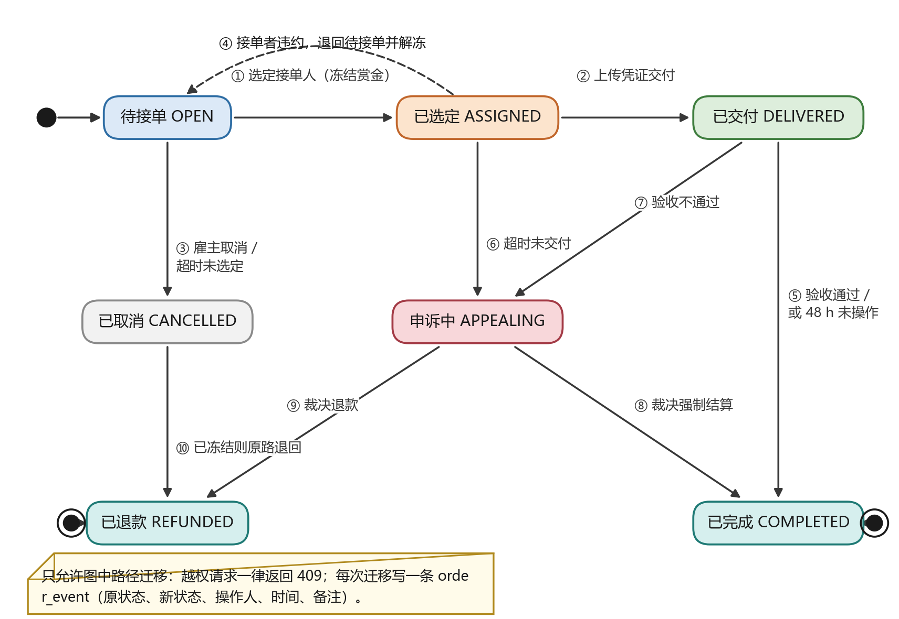
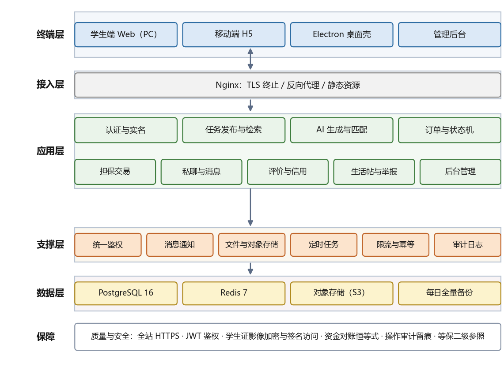
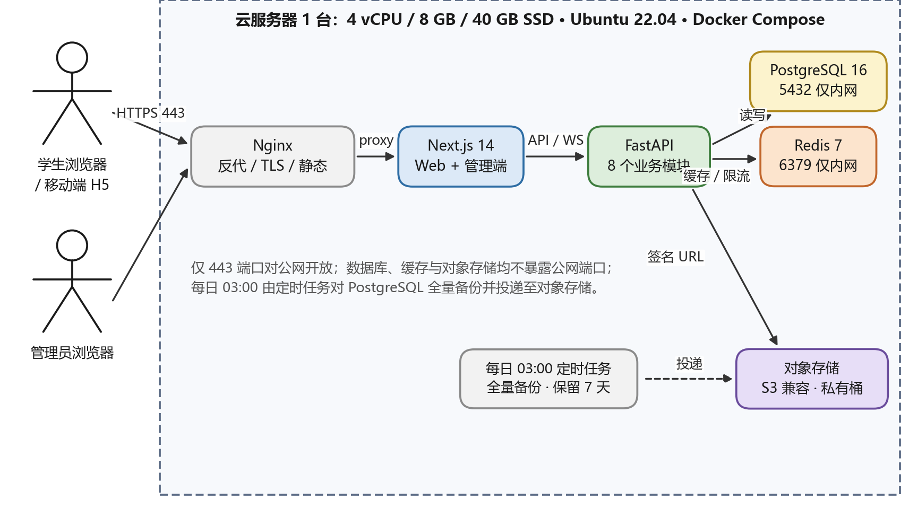

# 星火校园 · XingHuo-School

> 一个**仅限本校实名学生**、以**平台担保**完成交易的校园任务互助平台。

[](#)
[](#12-团队分工)
[](#11-路线图)
[](#4-系统架构)
[](#声明)

同学之间互相帮忙这件事，一直存在：帮拿快递、讲高数、重装系统、打印资料、搬器材。**但它至今没有一个像样的载体**——大家把需求丢进几百人的微信群，然后靠运气。

星火校园想做的事只有一件：把“发在群里的口头约定”变成“有凭证、有约束、可追溯的履约过程”。取“星火微光，互相帮扶”之意。

---

## 目录

- [1. 背景与痛点](#1-背景与痛点)
- [2. 五套核心机制](#2-五套核心机制)
- [3. 功能范围](#3-功能范围)
- [4. 系统架构](#4-系统架构)
- [5. 技术栈](#5-技术栈)
- [6. 前后端技术要求](#6-前后端技术要求)
- [7. 数据与接口约定](#7-数据与接口约定)
- [8. 本地运行](#8-本地运行)
- [9. 目录结构](#9-目录结构)
- [10. 开发流程与门禁](#10-开发流程与门禁)
- [11. 路线图](#11-路线图)
- [12. 团队分工](#12-团队分工)
- [13. 文档](#13-文档)
- [声明](#声明)

---

## 1. 背景与痛点

校园互助需求长期存在，但承载它的工具（群聊）不是为交易设计的。把需求发在群里，会同时产生三个问题：

| 痛点 | 具体表现 | 后果 |
| --- | --- | --- |
| **信息分散** | 需求几分钟就被聊天记录顶掉；有能力的同学也看不到与专业、空闲时段对口的任务 | 供需双向都在“碰运气” |
| **陌生交易缺约束** | 代取快递先付钱还是先跑腿？辅导课要不要先付定金？没有任何一方能给对方“放心”的理由 | 放鸽子、货不对板、收钱失联，无凭证也无仲裁 |
| **履历不留痕** | 帮人修了十次电脑，这件事在任何地方都查不到 | 好人得不到回报，下次还要从“你靠谱吗”重新开始 |

这三个痛点分别对应本平台的 **AI 匹配**、**平台担保 + 状态机**、**双向评价 + 信用分**，它们不是三个孤立功能，而是同一条主线上的三个环节。

**目标用户**：只有一个群体——本校在读学生，且必须完成学生证认证。不面向校外，不面向教职工，不做跨校经营。

**典型场景**：快递代拿（5～10 元）、课程辅导（同专业高分同学）、电脑维修（计科/软工标签）、生活互助（拼单打印、二手教材、找搭子自习）。

## 2. 五套核心机制

| 机制 | 解决的问题 | 实现要点 |
| --- | --- | --- |
| **实名准入** | 校外人员混入、交易对手不可信 | 学生证影像 + 学号段规则初筛 + 人工审核；未认证账号只能浏览，不能发布与接单 |
| **平台担保** | 雇主赖账、接单者收钱跑单 | 悬赏金在“选定接单人”时即冻结在平台担保账户，验收通过才打给接单者；异常可退款 |
| **状态机管控** | 重复接单、超卖、反复改状态 | 7 个状态、10 条允许迁移，越权迁移一律 409；每次迁移写一条 `order_event` |
| **AI 匹配** | 发布太麻烦、找不到对口单子 | 发布侧一句话生成任务草稿；接单侧按专业标签/信用分/历史类别召回与精排 |
| **双向信用** | 好人没回报、纠纷无依据 | 完成订单双向评价，信用分回流到下一轮匹配与推荐排序 |

订单状态机是整套机制的骨架（[大图](docs/images/order-state-machine.png)）：



> 三条实现纪律：**单一入口**（只能走服务层 `transition()`）、**留痕**（每次迁移写 `order_event`）、**幂等**（超时任务可重复触发而不产生二次迁移）。

## 3. 功能范围

按 MoSCoW 划分：**Must 25 项**构成本期交付基线，Should 11 项在 Must 全部验收通过后按剩余工时追加，Could 项仅在最后一周有余量时入选。功能分 9 个模块、36 个功能项。

| 模块 | 主要功能 | 优先级 |
| --- | --- | --- |
| 账号与实名认证 | 注册登录、JWT 鉴权、学生证上传、学院/专业/年级标签、管理员审核 | Must |
| 任务发布与检索 | 发布任务、AI 一句话生成草稿、编辑取消、大厅列表、筛选搜索、任务详情 | Must / Should |
| AI 生成与匹配 | 一句话生成草稿、接单侧推荐排序、大模型接入（预留） | Must / Should |
| 接单与订单状态机 | 申请接单（上限 5 人）、选定与冻结、状态迁移、超时兜底、并发防重 | Must |
| 资金担保 | 钱包双账（可用/冻结）、担保冻结、验收打款、取消退款、流水与每日对账 | Must |
| 私聊与消息 | 任务绑定会话、消息落库与推送、未读数与离线拉取、图片消息 | Must / Should |
| 评价与信用 | 双向评价、信用分计算与展示、历史完成单 | Must / Should |
| 生活帖与举报 | 生活帖发布与浏览、内容审核队列与敏感词拦截 | Should |
| 后台管理 | 违规下架与封禁、举报申诉仲裁、审计日志、数据导出 | Must（治理）/ Should |

**本期明确不做**：真实支付通道与提现、跨校/校外用户、语音视频、深度学习推荐、多校区多租户。
理由与替代方案见《软件需求说明书》第 3.1.8 节（随课程资料提交，需要可向团队索取）。

## 4. 系统架构



| 层 | 职责 | 关键约束 |
| --- | --- | --- |
| 终端层 | 学生端响应式 Web（一套代码适配 PC 与移动端）、管理后台、可选 Electron 桌面壳 | 不做双端并行维护 |
| 接入层 | Nginx：TLS 终止、反向代理、静态资源 | 只有 443 对公网开放 |
| 应用层 | FastAPI 单体服务，8 个业务模块 | 单体 + 分层，不引入微服务与消息队列 |
| 支撑层 | 统一鉴权、消息通知、文件与对象存储、定时任务、限流与幂等、审计日志 | 横切能力统一收口，业务模块不各写一套 |
| 数据层 | PostgreSQL 16、Redis 7、S3 兼容对象存储、每日全量备份 | 数据库/缓存/对象存储均不暴露公网端口 |

**为什么是单体**：三人九周的项目，任何一次分布式排障都会吃掉一整周。一份 `docker-compose.yml` 起全部服务，是这个规模下最合理的选择。

部署形态（[大图](docs/images/deploy-topology.png)）：



## 5. 技术栈

| 层次 | 选择 | 版本 | 为什么 | 放弃的替代 |
| --- | --- | --- | --- | --- |
| 前端 | Next.js + TypeScript + Tailwind CSS | 14 / 5.x / 3.x | SSR 有利于首屏；一套代码适配 PC 与移动端 | 纯 CSR 首屏慢；Flutter 双端维护成本翻倍 |
| 后端 | FastAPI + SQLAlchemy + Alembic | Python 3.12 | 异步性能足够、团队最熟、OpenAPI 文档自动生成 | Spring Boot 学习成本高 |
| 数据库 | PostgreSQL | 16 | 事务与约束强，支持 JSONB 与部分索引 | MySQL 亦可，选 PG 因团队更熟 |
| 缓存 | Redis | 7 | 任务大厅热点、会话与在线状态、限流计数 | —— |
| 实时通信 | WebSocket（FastAPI 原生） | —— | 私聊与消息推送必需 | 轮询延迟高、服务器压力大 |
| AI | 规则 + 轻量分类模型，预留大模型接口 | —— | 不依赖付费 API 也能演示 | 直接用大模型：成本与网络不可控 |
| 存储 | S3 兼容对象存储（MinIO / 云厂商） | —— | 学生证影像与凭证图片，签名链接访问 | 本地磁盘无法水平扩展 |
| 部署 | Docker Compose + Nginx，单机 4C8G | 24.x | 一条命令起全栈，一人可运维 | K8s 对三人项目是过度设计 |
| 测试 | pytest / httpx / Playwright / JMeter | 最新稳定版 | 单元、接口、端到端、性能四层 | —— |

> 版本在项目启动时冻结，中途不升级大版本。

## 6. 前后端技术要求

完整规范见 **[docs/技术要求.md](docs/技术要求.md)**，这里是必须记住的部分。

### 6.1 后端（FastAPI）

| 要求 | 具体做法 |
| --- | --- |
| **分层** | `router`（路由与校验）→ `service`（业务与事务）→ `repository`（数据访问）→ `schema`（出入参）。**业务逻辑不许写在 router 里** |
| **状态机单一入口** | 订单状态只能通过 `order_service.transition(order_id, from, to, operator)` 迁移，任何位置禁止直接 `UPDATE status`；每次迁移写 `order_event` |
| **并发防重** | 抢单用条件更新：`UPDATE orders SET status='ASSIGNED' WHERE id=:oid AND status='OPEN'`，以影响行数判定胜负；另加 `UNIQUE(task_id)` 兜底。**禁止"先查再改"** |
| **金额** | 一律 `DECIMAL(10,2)`，Python 侧用 `Decimal`，序列化为字符串。**禁止 float/double** |
| **事务** | 涉及资金的写操作必须在单一事务内完成（冻结、打款、退款），任一步失败整体回滚 |
| **对账** | 每日 03:30 校验 `Σ可用 + Σ冻结 = Σ流水净额`，不成立即冻结全站写操作并告警 |
| **消息** | WebSocket 先落库再推送；断线重连后按会话补拉未读 |
| **定时任务** | 超时扫描（每分钟）、对账（每日）、备份（每日 03:00），全部幂等并提供手工补跑 |
| **日志与审计** | 结构化日志；密码、令牌、学号、证件影像地址一律脱敏；管理动作写 `audit_log` |
| **测试** | 状态机、金额计算、权限判定必须有单元测试，覆盖率 ≥ 70%；含“50 线程并发抢单成功数 = 1”用例 |
| **风格** | `ruff` + `black` + 类型注解；交付前 `ruff check` 零告警 |

### 6.2 前端（Next.js）

| 要求 | 具体做法 |
| --- | --- |
| **类型** | TypeScript `strict: true`，**禁止 `any`**；接口类型由后端 OpenAPI 生成，不手写两套 |
| **路由** | App Router；列表与详情用 Server Component 首屏直出，交互部分下沉客户端组件 |
| **筛选状态** | 分类、酬劳区间、排序等筛选条件放 **URL 查询参数**，保证可分享、可回退 |
| **数据获取** | 客户端交互用统一的 fetcher 封装（自动带 JWT、统一错误处理、401 跳登录）；不做重复请求 |
| **表单校验** | React Hook Form + Zod，规则与后端对齐；**服务端校验为准**，前端只为体验 |
| **状态呈现** | 订单状态 → 按钮可用性必须查表实现（见技术要求 §3.8），不允许在各页面各写一套 `if` |
| **错误处理** | 403/409/422/429 各有固定文案与下一步动作；不允许只弹“操作失败” |
| **实时消息** | 单例 WS 连接，指数退避重连、心跳、未读数同步；页面切换不重复建连 |
| **性能** | 首屏可交互 ≤ 2.5 s（4G、中端机）；图片懒加载与压缩；首屏不加载管理端代码 |
| **风格** | ESLint + Prettier + husky `pre-commit`；提交前必须通过 lint 与类型检查 |

### 6.3 前后端协作契约

- **接口先行**：后端先出 OpenAPI（FastAPI 自动生成），前端据此生成类型与 Mock，双方按文档联调；
- **枚举单一来源**：订单状态、任务分类、错误码在仓库内**只有一处定义**，前后端都从它派生，禁止各写各的字符串；
- **统一响应结构**：`{ code, msg, data }`，HTTP 状态码表达语义，`code` 用于细分业务原因；
- **命名与格式**：JSON 字段 `snake_case`；金额字符串两位小数；时间 ISO 8601（UTC+8）；分页 `page/page_size/total/items`。

## 7. 数据与接口约定

**核心实体 12 个**：`user`、`student_verify`、`task`、`order`、`order_event`、`wallet`、`fund_flow`、`chat_session`、`message`、`review`、`report`、`post`（另有治理表 `audit_log`）。

**设计原则**：能用约束表达的，不写在代码里——唯一索引、外键、状态枚举、余额非负全部落到数据库层。

**错误码**：

| HTTP | code | 含义 | 前端处理 |
| --- | --- | --- | --- |
| 400 | `BAD_REQUEST` | 请求格式错误 | 提示重试 |
| 401 | `UNAUTHORIZED` | 未登录或令牌过期 | 跳登录，回跳原页面 |
| 402 | `INSUFFICIENT_BALANCE` | 可用余额不足 | 提示充值（管理员入账） |
| 403 | `FORBIDDEN` / `NOT_VERIFIED` | 无权限 / 未实名 | 引导实名认证 |
| 404 | `NOT_FOUND` | 资源不存在或已下架 | 返回列表 |
| 409 | `CONFLICT` / `TASK_TAKEN` | 状态冲突 / 已被抢走 | 刷新详情 |
| 422 | `VALIDATION_FAILED` | 校验失败（含违规词） | 高亮字段并说明 |
| 429 | `TOO_MANY_REQUESTS` | 限流 / 申请已满 | 提示稍后或换个任务 |
| 500 | `INTERNAL_ERROR` | 服务异常 | 提示稍后，附 trace_id |

**接口规模**：16 个 REST 接口 + 1 个 WebSocket 通道（清单见 [技术要求.md 附录 A](docs/技术要求.md#附录-a接口清单)）。

## 8. 本地运行

> 脚手架随 **W3–W4** 一并提交，以下命令届时可用（当前仓库处于需求与设计收尾阶段，见[路线图](#11-路线图)）。

```bash
# 1. 准备环境变量
cp .env.example .env          # 填入数据库、Redis、对象存储、JWT 密钥

# 2. 一键起全栈（前端 + 后端 + 数据库 + 缓存 + 对象存储）
docker compose up -d

# 3. 初始化数据库
docker compose exec api alembic upgrade head
```

| 服务 | 地址 |
| --- | --- |
| 学生端 / 管理端 | http://localhost:3000 |
| 后端 API 文档（Swagger） | http://localhost:8000/docs |
| 对象存储控制台 | http://localhost:9001 |

不依赖 Docker 的本地开发：

```bash
# 后端
cd apps/api && pip install -r requirements.txt
uvicorn app.main:app --reload

# 前端
cd apps/web && pnpm install
pnpm dev
```

## 9. 目录结构

```text
XingHuo-School/
├── apps/
│   ├── web/                 # Next.js 14：学生端 + 管理端（同一工程）
│   │   ├── app/             # App Router 路由
│   │   ├── components/      # 通用组件
│   │   ├── features/        # 按业务域组织的组件与 hooks
│   │   ├── lib/             # fetcher、ws、鉴权、工具
│   │   └── types/           # 由 OpenAPI 生成的接口类型
│   └── api/                 # FastAPI
│       ├── app/
│       │   ├── routers/     # 路由层
│       │   ├── services/    # 业务与事务（状态机、担保、对账）
│       │   ├── repositories/# 数据访问
│       │   ├── schemas/     # 出入参
│       │   ├── models/      # ORM 模型
│       │   ├── core/        # 配置、鉴权、日志、异常
│       │   └── tasks/       # 定时任务
│       ├── alembic/         # 数据库迁移
│       └── tests/           # pytest（含并发用例）
├── docs/
│   ├── images/              # 架构图、状态机图、部署拓扑
│   └── 技术要求.md           # 前后端技术规范（必读）
├── deploy/                  # docker-compose、Nginx 配置
├── .env.example
└── README.md
```

## 10. 开发流程与门禁

**分支模型**：`main`（可交付）← `dev`（集成）← `feat/*`、`fix/*`（个人）。合并到 `main` 必须走 PR，且 CI 通过。

**提交规范**（Conventional Commits）：

```text
feat(order): 支持条件更新抢单并写 order_event
fix(wallet): 修复退款时未写 REFUND 流水
docs(readme): 补充前后端技术要求
```

**PR 检查单**：接口有 OpenAPI 变更说明 / 状态机迁移只走 `transition()` / 金额未用浮点 / 有测试 / lint 通过 / 无敏感信息硬编码。

**硬门禁**（不通过即停，宁可推迟后续功能也不带缺陷进入下一周）：

| 门禁 | 内容 |
| --- | --- |
| G1 | 状态机与数据模型评审通过 |
| G2 | 本地 30 分钟内一键起全栈 |
| G4 | 50 并发抢单，仅 1 单成功 |
| G5 | 5 条 E2E 主链路全绿 |
| G7 | P0/P1 缺陷清零 |

## 11. 路线图

| 阶段 | 内容 | 状态 |
| --- | --- | --- |
| W1–W2 | 可行性分析报告、需求说明书、用例与状态机、原型稿 | ✅ 文档已完成 |
| W3–W4 | 脚手架与认证：前后端框架、数据库建表、实名认证、登录鉴权 | ⏳ 进行中 |
| W5–W6 | 核心闭环：发布、抢单、私聊、担保、验收、状态机、AI 基础逻辑 | ⏳ 待开始 |
| W7–W8 | 测试与加固：全套用例（正常 + 异常）、性能优化、缺陷清零 | ⏳ 待开始 |
| W9 | 试点与答辩：试点数据、演示视频、答辩 PPT | ⏳ 待开始 |

功能级待办：

- [x] 可行性分析（技术/经济/进度/运营/合规五维）
- [x] 软件需求说明书（GB 856T—88 四章结构）
- [x] 用例模型与订单状态机设计
- [ ] 数据库 schema 与迁移脚本
- [ ] 实名认证 + JWT 鉴权
- [ ] 任务发布 / 大厅 / 申请接单
- [ ] 状态机 + 条件更新抢单
- [ ] 担保交易与对账任务
- [ ] 私聊 WebSocket
- [ ] 评价与信用分
- [ ] 后台审核与仲裁
- [ ] E2E 与并发测试
- [ ] 试点上线与数据复盘

## 12. 团队分工

三人小组，一人一域 + 交叉评审（R 执行 / A 担责 / C 咨询 / I 知会）。

| 交付物 | 刘静怡（队长） | 付苏琪 | 吕振楠 |
| --- | --- | :-: | :-: |
| 可行性分析报告 / 需求规格说明书 | R/A | C | C |
| 用例图、状态机、需求评审 | R/A | C | R |
| 高保真原型与 UI | C | R/A | I |
| 前端与客户端实现 | I | R/A | C |
| 数据库设计 | C | I | R/A |
| 后端接口与并发控制 | C | C | R/A |
| 测试用例与测试报告 | R/A | C | C |
| 部署与运维 | I | C | R/A |
| 答辩 PPT 与演示 | R/A | R | C |

## 13. 文档

| 文档 | 说明 |
| --- | --- |
| [docs/技术要求.md](docs/技术要求.md) | **前后端技术规范**：分层、接口、状态机、资金、并发、测试、代码风格 |
| [docs/images/architecture.png](docs/images/architecture.png) | 系统总体架构 |
| [docs/images/order-state-machine.png](docs/images/order-state-machine.png) | 订单状态机 |
| [docs/images/deploy-topology.png](docs/images/deploy-topology.png) | 部署拓扑 |

---

## 声明

- 本项目为**软件工程课程综合大作业**，用于学习与教学演示，不进行商业运营；
- 资金为**平台内模拟担保**：钱包余额由管理员线下收款后入账，仅在站内闭环流转，**不接入任何真实支付通道，不支持提现**；
- 实名认证采用“学号段规则初筛 + 人工比对”，**不对接学校学籍系统**；学生证影像按敏感个人信息处理（加密存储、签名访问、查看留痕、认证后不展示原图）；
- 代码与文档仅供学习交流，**未声明开源许可**，转载请注明出处。
